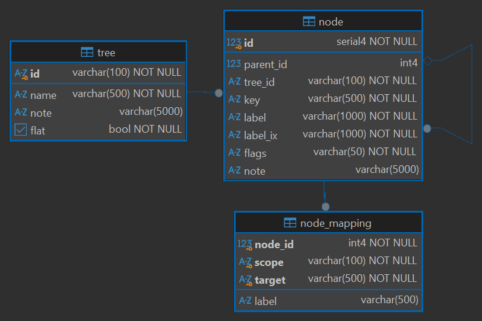

# TaxoStore

A simple tree store mainly designed for hierarchical taxonomies, implemented with PostgreSQL and served through an ASP.NET Core Web API.

## Overview

This solution contains a very simple store for node trees, backed by a PostgreSQL database. It allows you to create, read, update, and delete nodes in a tree structure. The store is then wrapped in an ASP.NET Core Web API for easy access.

The **tree** is just a named tree with a string ID (key), a human-friendly name, an optional note, and a `flat` flag. A flat tree is just a list: all its nodes are root nodes (see [Flat Trees](#flat-trees)).

The **node** is a simple structure with:

- a numeric ID and parent ID.
- a string tree ID (referencing the tree's key).
- a human-friendly ID string (key) that is unique only within its tree.
- a human-friendly label string and its searchable (filtered) counterpart.
- a set of flags where each character represents a boolean attribute.
- an optional note.
- any number of optional **mappings** to equivalent entities in external resources (see [Node Mappings](#node-mappings)).



### Flat Trees

A tree can be marked as _flat_ to tell that it is just a list of root-level nodes, with no hierarchy. Internally nothing changes, because a flat tree is still a tree whose nodes happen to have no parent; the flag is mainly a hint for frontends, which can render such trees as plain lists.

The store enforces this constraint:

- a node cannot be saved with a parent in a flat tree.
- a tree cannot be set as flat while it has non-root nodes.

In both cases the store throws an `ArgumentException`, which the API maps to a 400 response.

### Node Mappings

Each node can be mapped to any number of external identifiers. The purpose is to map the entity represented by the node to its equivalents in popular external authority lists, such as VIAF, geographical gazetteers, Biblissima+, Getty, etc. This way, you can build a "facade" taxonomy where each node carries the mappings to all the relevant authority lists: mappings are specified once when entering the node, and then used for integration and alignment with those lists.

A mapping has:

- `scope` (max 100 characters): the external resource the target belongs to. For instance, if the target is a VIAF record ID, which is just a number, a scope equal to `viaf` tells which resource that number refers to.
- `target` (max 500 characters): the ID of the equivalent entity in that resource, e.g. the VIAF ID.
- `label` (max 500 characters, optional): a human-friendly label for the target.

A mapping is identified by its node, scope and target (the primary key of table `node_mapping`), so the same node cannot have the same target in the same scope more than once, while different nodes can be mapped to the same target.

Mappings are read and written together with their node:

- **reading**: all the methods and endpoints returning nodes have an `includeMappings` option, false by default, so that mappings are fetched only when requested (with a single additional query, whatever the number of nodes). When not requested, the node's `mappings` are null; when requested, they are an array, empty if the node has no mappings, sorted by scope and target.
- **writing**: when saving a node, a null (or omitted) `mappings` property leaves the mappings of that node untouched; any other value replaces them all, so that an empty array removes all the mappings of the node. This means that you can safely read a node without its mappings, edit it and save it back without losing them.
- **searching**: nodes can be filtered by the exact scope and/or target of their mappings (`mappingScope`, `mappingTarget`), e.g. to find the node mapped to a given VIAF ID.
- deleting a node also deletes its mappings.

### Computed Position Properties

For tree visualization and navigation purposes, the API can compute and return additional properties:

- **Y (depth)**: The depth level of a node in the tree hierarchy (1-based). Root nodes have Y=1, their children have Y=2, and so on.
- **X (sibling position)**: The position of a node among its siblings (1-based), ordered alphabetically by key. The first sibling has X=1, the second X=2, etc.
- **HasChildren**: A boolean indicating whether the node has any children.

These properties are **computed at runtime**, not stored in the database (for any set of nodes, they are got with a single query). This design choice avoids the overhead of maintaining these values during tree mutations (inserts, updates, deletes, moves), which would be particularly problematic with concurrent updates. Instead, the values are calculated on-demand when requested.

- **Single-node endpoints** (`GET /api/taxostore/nodes/{id}` and `GET /api/taxostore/nodes/tree/{treeId}/key/{key}`) always return the positioned model with X, Y, and HasChildren values.
- **Bulk endpoints** (children, descendants, ancestors, filtered queries) accept an optional `includePosition` query parameter. When set to `true`, X, Y, and HasChildren values are computed and included; otherwise they are omitted for better performance.

So, the note data essentially consists only in its identity and the corresponding human-friendly label, plus an optional note and a bunch of customizable flags. This is generic enough and fit to its primary purposes, which is providing taxonomies which can be either flat (when all nodes are root nodes) or hierarchical.

For instance, imagine a taxonomy like that of IconClass for iconographic "keywords". The taxonomy which will be used will use strings as identifiers for both trees and nodes. These will usually be meaningful IDs, like `christ.hand.right.up` for a node (where each dot here represents a step down the tree), and `iconography` for a tree; but this is up to the taxonomy we want to represent. The store is generic enough to represent any taxonomies, like e.g. product categories, where each category can have subcategories, and each category and subcategory can have a unique key and label.

> If you need to attach more data to nodes, you can further extend this project by adding new tables which provide more data payload attached to each node.

The intended first application of this project is having any number of massive editable taxonomies with high performance for read operations in those [Cadmus](https://vedph.github.io/cadmus-doc)-based projects which rely on huge taxonomies, and still allow users to edit the taxonomy when required.

### Identifiers

The project is designed to use numeric IDs for internal operations (primary keys, foreign keys) and human-friendly string keys for external references (e.g., API calls). This allows for efficient database operations while maintaining usability in external interfaces.

Trees have a unique string key (ID) that can be used to reference them externally, while nodes have a unique string key within their respective tree and internally just use a numeric ID, which is more compact and efficient.

So, a node key is granted to be unique only within its tree, not globally. If you want to have a globally unique node key (besides its numeric ID, which is internal to the database), you need to prefix it with the tree key followed by some separator, like a slash or a dot.

## Projects

- `TaxoStore.Core`: core interfaces and models.
- `TaxoStore.PgSql`: PostgreSQL implementation of the store.
- `TaxoStore.Api.Controllers`: ASP.NET Core Web API controllers and services for the store.
- `TaxoStore.Api`: ASP.NET Core Web API host for the store. This is essentially for demo and testing purposes, as usually consumer APIs will integrate the controllers from `TaxoStore.Api.Controllers` in their own host. This API also includes authentication and authorization using JWT bearer tokens, because the controllers require authentication.
- `TaxoStore.Cli.Core`: Spectre.Console.Cli commands shared by the command-line tool.
- `taxo-tool`: command-line tool (see [Command-Line Tool](#command-line-tool-taxo-tool) below).

## Integration Guide

This section explains how to integrate the TaxoStore into your ASP.NET Core Web API project. The integration follows ASP.NET best practices using the service extension pattern for clean, maintainable configuration.

> ⚠️ It is assumed that your ASP.NET Core Web API implements authentication, as the TaxoStore controllers require authenticated access.

The integration relies on three main components in the `TaxoStore.Api.Controllers.Services` namespace:

1. **TaxoStoreServiceOptions**: Configuration options for the store
2. **TaxoStoreServiceExtensions**: Extension methods for registering services
3. **TaxoStoreInitializationService**: Background service for automatic database initialization

### Step 1: Add Package References

Add packages to the required projects in your API's `.csproj` file (update version numbers accordingly):

```xml
<ItemGroup>
  <PackageReference Include="TaxoStore.Api.Controllers" Version="0.0.8" />
  <PackageReference Include="TaxoStore.Core" Version="0.0.8" />
  <PackageReference Include="TaxoStore.PgSql" Version="0.0.8" />
</ItemGroup>
```

### Step 2: Configure Connection String

Add the TaxoStore connection string to your `appsettings.json`:

```json
{
  "ConnectionStrings": {
    "TaxoStore": "Server=localhost;Database=trees;User Id=postgres;Password=postgres;Include Error Detail=True"
  },
  "TaxoStore": {
    "EnableAutoInitialization": true,
    "InitializationDelaySeconds": 0
  }
}
```

Configuration options in `TaxoStore`:

- `EnableAutoInitialization`: when `true`, automatically creates the database schema and seeds data on startup (default: `true`).
- `InitializationDelaySeconds`: delay before initialization starts, useful in Docker environments where PostgreSQL needs startup time (default: `0`).

### Step 3: Register TaxoStore Services

In your `Program.cs`, register the TaxoStore services and controllers:

```cs
using TaxoStore.Api.Controllers;
using TaxoStore.Api.Controllers.Services;

var builder = WebApplication.CreateBuilder(args);

// Add standard services
builder.Services.AddControllers();

// Register controllers from TaxoStore.Api.Controllers assembly
builder.Services.AddControllers()
    .AddApplicationPart(typeof(TreeController).Assembly)
    .AddControllersAsServices();

// Register TaxoStore services
builder.Services.AddTaxoStoreServices(options =>
{
    string? connectionString = builder.Configuration
        .GetConnectionString("TaxoStore");
    if (string.IsNullOrEmpty(connectionString))
    {
        throw new InvalidOperationException(
            "Connection string 'TaxoStore' not found.");
    }

    options.ConnectionString = connectionString;

    options.EnableAutoInitialization =
        builder.Configuration.GetValue("TaxoStore:EnableAutoInitialization", true);

    options.InitializationDelaySeconds =
        builder.Configuration.GetValue("TaxoStore:InitializationDelaySeconds", 0);
});

var app = builder.Build();

// Configure middleware
app.UseAuthorization();
app.MapControllers();

app.Run();
```

### Step 4: Optional - Seed Data from CSV Files

The TaxoStore supports automatic database seeding from CSV files. When the database is created for the first time, it will automatically import data from CSV files if they are present.

By default, `AddTaxoStoreServices` looks for seed files at:

- `wwwroot/taxo/trees.csv`: tree definitions. Each tree is implicitly numbered with an ordinal when importing it, which makes it easier to refer nodes to it. The first imported tree is 1, the second 2, and so forth. So, in the nodes file you will refer to 1 for the first tree, 2 for the second, and so forth.
- `wwwroot/taxo/nodes.csv`: node data.
- `wwwroot/taxo/mappings.csv`: node mappings data. This file is optional.

If these files exist, they will be automatically used for seeding when the database is first created.

**CSV File Formats:**

- 📁 `trees.csv`:

```csv
id,name,note,flat
products,Products,"Product taxonomy",
categories,Categories,"Category hierarchy",
colors,Colors,"A flat list of colors",true
```

- 📁 `nodes.csv`:

```csv
tree_n,parent_key,key,label,filtered_label,flags,note
1,,electronics,Electronics,electronics,,
1,electronics,computers,Computers,computers,,"Desktops, laptops, and servers"
1,electronics,phones,Mobile Phones,mobile phones,,
2,,food,Food & Beverages,food beverages,,
3,,red,Red,red,,
```

- 📁 `mappings.csv` (optional):

```csv
tree_n,node_key,scope,target,label
1,computers,wikidata,Q68,computer
1,computers,getty,300212998,computers
3,red,getty,300126225,red (color)
```

Fields in `trees.csv`:

- `id`: unique tree identifier (key), used to reference the tree externally.
- `name`: human-friendly display name for the tree.
- `note`: optional descriptive note about the tree.
- `flat`: optional column; `true`, `1`, `yes` or `y` (case-insensitive) for a flat tree, anything else (or empty) for a hierarchical tree. Nodes of a flat tree must have an empty `parent_key`.

Fields in `nodes.csv`:

- `tree_n`: tree number (1-based index from trees.csv).
- `parent_key`: key of the parent node (empty for root nodes).
- `key`: unique identifier within the tree.
- `label`: display label.
- `filtered_label`: searchable label (auto-generated if empty).
- `flags`: optional flags string.
- `note`: optional note (the column itself can be omitted). Like any other field, it must be wrapped in double quotes when it includes the delimiter, quotes (escaped by doubling them) or line breaks.

Fields in `mappings.csv`:

- `tree_n`: tree number (1-based index from trees.csv) of the mapped node.
- `node_key`: key of the mapped node. The node must be found in `nodes.csv`.
- `scope`: the scope of the target (e.g. `viaf`).
- `target`: the target ID.
- `label`: optional human-friendly label of the target.

> To specify custom paths for seed files:

```cs
builder.Services.AddTreeServices(options =>
{
    options.ConnectionString = builder.Configuration
        .GetConnectionString("TaxoStore")!;

    // Specify custom paths to CSV seed files
    options.SeedTreeSource = Path.Combine(
        builder.Environment.ContentRootPath, "Data", "my-trees.csv");

    options.SeedNodeSource = Path.Combine(
        builder.Environment.ContentRootPath, "Data", "my-nodes.csv");

    // optional
    options.SeedMappingSource = Path.Combine(
        builder.Environment.ContentRootPath, "Data", "my-mappings.csv");
});
```

Note:

- seeding only occurs when the database is **first created**.
- if the database already exists, seed files are ignored. To re-seed, drop the database and restart the application.
- the importer automatically generates filtered labels if not provided.
- a database created by a previous version of TaxoStore is automatically upgraded at initialization (see [Upgrading Existing Databases](#upgrading-existing-databases)).

### Upgrading Existing Databases

Flat trees and node mappings require a `flat` column in table `tree` and a new `node_mapping` table. When the store is initialized on a database which already exists, it runs an idempotent upgrade script which adds them when missing, leaving existing data untouched (existing trees are not flat, and nodes have no mappings). So, no manual migration is required; the database user must just be allowed to alter the schema. Should you prefer to upgrade the database by yourself, this is the script:

```sql
ALTER TABLE tree ADD COLUMN IF NOT EXISTS flat BOOLEAN NOT NULL DEFAULT FALSE;

CREATE TABLE IF NOT EXISTS node_mapping (
    node_id INT NOT NULL REFERENCES node(id) ON DELETE CASCADE,
    scope   VARCHAR(100) NOT NULL,
    target  VARCHAR(500) NOT NULL,
    label   VARCHAR(500),
    CONSTRAINT pk_node_mapping PRIMARY KEY (node_id, scope, target)
);

CREATE INDEX IF NOT EXISTS idx_node_mapping_scope_target ON node_mapping(scope, target);
```

### Available API Endpoints

Once integrated, the following endpoints become available:

- **Tree Endpoints** (via `TaxoTreeController`):
  - `GET /api/taxostore/trees/{id}` - Get a tree by its ID (string key).
  - `GET /api/taxostore/trees` - Get paginated trees with filtering (query params: pageNumber, pageSize, name).
  - `POST /api/taxostore/trees` - Create or update a tree (body: TreeBindingModel with id, name, note, flat). Returns 201 with the tree ID in the body; 400 if the tree is invalid (e.g. set as flat while it has non-root nodes).
  - `DELETE /api/taxostore/trees/{id}` - Delete a tree by its ID (string key).

- **Node Endpoints** (via `TaxoNodeController`):
  - `GET /api/taxostore/nodes/{id}` - Get a node by its numeric ID (query params: includeMappings). Returns `PositionedNodeModel` with X/Y/HasChildren.
  - `GET /api/taxostore/nodes/tree/{treeId}/key/{key}` - Get a node by tree ID (string) and node key (string) (query params: includeMappings). Returns `PositionedNodeModel` with X/Y/HasChildren.
  - `GET /api/taxostore/nodes` - Get paginated nodes with filtering (query params: pageNumber, pageSize, treeId, parentId, isRoot, key, parentKey, ancestorKey, filteredLabel, matchDescendants, flags, flagMatchMode, isLeaf, mappingScope, mappingTarget, includePosition, includeMappings). Notes:
    - `pageSize`=0 disables paging and returns all the matching nodes.
    - `key`, `parentKey`, `filteredLabel` match any part of the corresponding value (case-insensitive; `%` and `_` are matched literally).
    - `ancestorKey` is the exact key of an ancestor node: only its descendants (at any depth) are matched.
    - `matchDescendants`: when true with `filteredLabel`, a node matches also when any of its descendants match the label.
    - `flags` is a set of single-character flags; `flagMatchMode` is `any` (default: at least one flag present), `all` (all flags present), or `none` (no flag present).
    - `mappingScope`, `mappingTarget` match the exact scope and/or target of a mapping of the node (case-sensitive). When both are specified, they must be matched by the same mapping.
  - `GET /api/taxostore/nodes/roots/{treeId}` - Get root nodes of a tree (query params: pageNumber, pageSize, includePosition, includeMappings).
  - `GET /api/taxostore/nodes/{id}/haschildren` - Check if a node has children (returns boolean).
  - `GET /api/taxostore/nodes/{id}/children` - Get child nodes of a parent node (query params: includePosition, includeMappings).
  - `GET /api/taxostore/nodes/{id}/descendants` - Get all descendant nodes of a node, in depth-first order with siblings sorted by key (query params: includePosition, includeMappings).
  - `GET /api/taxostore/nodes/{id}/ancestors` - Get all ancestor nodes of a node (query params: includePosition, includeMappings).
  - `GET /api/taxostore/nodes/{id}/path` - Get the path from the root to a node, with the page number of each step (query params: pageSize).
  - `POST /api/taxostore/nodes` - Create or update a node (body: NodeBindingModel with id, parentId, treeId, key, label, filteredLabel, flags, note, mappings). Returns 201 with the node ID in the body; 400 if the node is invalid (e.g. missing tree or parent, parent in another tree, parent creating a cycle, parent in a flat tree, duplicate mappings); when `mappings` is null or omitted the node's mappings are left untouched, else they replace all the node's mappings (an empty array removes them); 409 if its key is already used in the same tree.
  - `POST /api/taxostore/nodes/batch` - Bulk create or update nodes (body: array of NodeBindingModel), in a single transaction: if any node is invalid, no node is saved.
  - `DELETE /api/taxostore/nodes/{id}` - Delete a node by its numeric ID.
  - `DELETE /api/taxostore/nodes` - Clear all data from the store.

> The `includePosition` query parameter (boolean, default `false`) controls whether X (sibling position), Y (depth), and HasChildren values are computed and included in the response. Set to `true` when position data is needed for visualization; omit or set to `false` for better performance when only node data is required.
>
> The `includeMappings` query parameter (boolean, default `false`) controls whether the [mappings](#node-mappings) of each node are fetched and included in the response.

Example of a node with mappings, as posted to `POST /api/taxostore/nodes`:

```json
{
  "id": 0,
  "treeId": "people",
  "key": "dante",
  "label": "Dante Alighieri",
  "mappings": [
    { "scope": "viaf", "target": "97105654", "label": "Dante Alighieri, 1265-1321" },
    { "scope": "wikidata", "target": "Q1067" }
  ]
}
```

### Docker Deployment

For Docker/containerized deployments where PostgreSQL may need startup time, configure an initialization delay:

```json
{
  "TaxoStore": {
    "EnableAutoInitialization": true,
    "InitializationDelaySeconds": 10
  }
}
```

This ensures the API waits for PostgreSQL to be ready before attempting initialization.

> When diagnosing seeding issues (e.g. a Docker deployment where the database is created but not seeded, or not created at all), check the application logs at `Information` level: `PgSqlTaxoStore` logs the connection target (host/port/database, credentials excluded), whether the database already existed, database creation, and seeding start/completion with tree/node counts. If a newly created database is left unseeded, a `Warning` explains why (missing or incomplete `SeedTreeSource`/`SeedNodeSource`). A common cause of "database not found" with no error logged is a misconfigured connection string that happens to point to an *existing* database (e.g. a copy-paste mistake reusing another service's connection string): the existence check then finds that unrelated database and silently skips creation of the intended one.

### Minimal Integration Example

Here's a complete minimal example:

```cs
using TaxoStore.Api.Controllers;
using TaxoStore.Api.Controllers.Services;

var builder = WebApplication.CreateBuilder(args);

builder.Services.AddControllers()
    .AddApplicationPart(typeof(TaxoTreeController).Assembly);

builder.Services.AddTaxoStoreServices(options =>
{
    options.ConnectionString = builder.Configuration
        .GetConnectionString("TaxoStore")!;
});

var app = builder.Build();
app.MapControllers();
app.Run();
```

With corresponding `appsettings.json`:

```json
{
  "ConnectionStrings": {
    "TaxoStore": "Server=localhost;Database=taxo;User Id=postgres;Password=postgres"
  }
}
```

## Command-Line Tool (taxo-tool)

`taxo-tool` is a console application (`TaxoStore.Cli.Core` provides the commands, `Fusi.Cli.Config`/`Fusi.Cli.Logging` provide configuration and logging) that can create and seed a TaxoStore PostgreSQL database from CSV files outside of a running API host — e.g. for local setup, deployment scripts, or CI. It reuses the same initialization logic as the API (`PgSqlTaxoStore.InitializeAsync`): the database is created only if it does not already exist, and is seeded from the given CSV files immediately after creation; if the database already exists, the command does nothing.

### import-store

```sh
taxo-tool import-store <TREES_CSV> <NODES_CSV> -d <DATABASE_NAME> [-m <MAPPINGS_CSV>] [-c <CONNECTION_TEMPLATE>]
```

- `TREES_CSV`, `NODES_CSV`: paths to the seed CSV files (same format as [described above](#step-4-optional---seed-data-from-csv-files)).
- `-d`/`--database`: name of the database to create and seed.
- `-m`/`--mappings`: optional path to the seed CSV file with node mappings.
- `-c`/`--connection`: optional PostgreSQL connection string template, with `{0}` as a placeholder for the database name (e.g. `Server=localhost;Database={0};User Id=postgres;Password=postgres`). When omitted, it is read from the `TaxoStore` connection string in the tool's own configuration (`appsettings.json`/`appsettings.local.json`/environment variables, resolved next to the tool's executable).

Example `appsettings.json` next to `taxo-tool.exe`:

```json
{
  "ConnectionStrings": {
    "TaxoStore": "Server=localhost;Database={0};User Id=postgres;Password=postgres;Include Error Detail=True"
  }
}
```

Example usage, creating and seeding database `taxo`:

```sh
taxo-tool import-store wwwroot/taxo/trees.csv wwwroot/taxo/nodes.csv -d taxo
```

The same, also importing node mappings:

```sh
taxo-tool import-store wwwroot/taxo/trees.csv wwwroot/taxo/nodes.csv -m wwwroot/taxo/mappings.csv -d taxo
```
